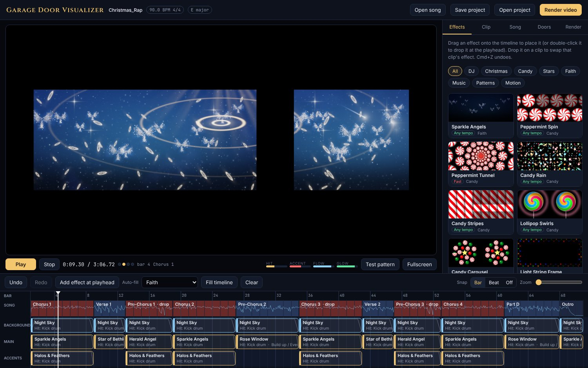

# Garage Door Visualizer

Music-reactive light shows for projection-mapped garage doors. Drop in a song, place effects on a timeline, preview with audio, and render a video for each door.

**Download:** [Mac (Apple Silicon)](https://github.com/Leviblack12/garage-door-visualizer/releases/latest/download/Garage-Door-Visualizer-mac-apple-silicon.dmg) · [Mac (Intel)](https://github.com/Leviblack12/garage-door-visualizer/releases/latest/download/Garage-Door-Visualizer-mac-intel.dmg) · [Use it in the browser](https://leviblack12.github.io/garage-door-visualizer/app.html)



## Features
- In-app song analysis: beats, bars, kick/snare/hats, bass, melody, vocals and named song parts (Intro, Verse, Chorus, Bridge...).
- Timeline with three tracks. Drag effects in; each clip picks what it reacts to and can step patterns across the door panels.
- 66 effects: DJ lights, Christmas lights, candy, stars, sparkle angels, faith scenes, snow, music and patterns.
- Undo/redo (Cmd+Z / Shift+Cmd+Z).
- Render each door as its own video at the door's shape, or both doors in one 16:9 video using a 4-corner projection mapping.

## First open on a Mac
The app is ad-hoc signed (no paid Apple certificate). Open it once, then System Settings > Privacy & Security > Open Anyway.
If macOS says it is damaged: `xattr -dr com.apple.quarantine "/Applications/Garage Door Visualizer.app"`

## Building
```
python3 source/build.py      # source/src -> app/index.html and docs/app.html
npm install
npm start                    # run the Mac app
npm run dist                 # build dist/Garage-Door-Visualizer-mac-apple-silicon.dmg (bash scripts/make-dmg.sh x64 for Intel)
```

Video export uses [mp4-muxer](https://github.com/Vanilagy/mp4-muxer) (MIT).
